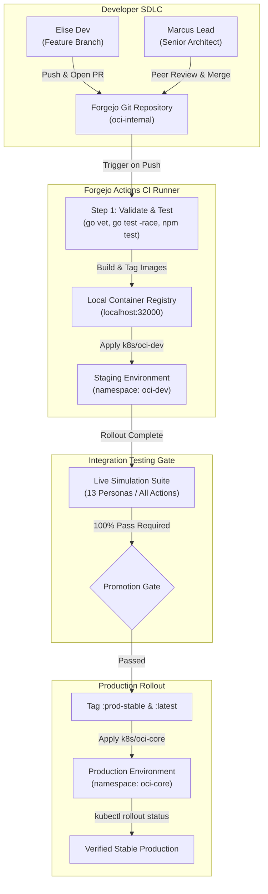

# ADR 0003: Self-Hosted GitOps, Multi-Stage Containerization & Gated Promotion Pipeline

* **Status:** Accepted
* **Date:** 2026-10-15
* **Author:** Marcus Lead (`emp-human-marcus`), Principal Systems Architect & Senior Developer
* **Context:** Architectural specification for implementing Future Work 7.6: Self-hosted software development lifecycle, secure multi-stage container packaging, continuous integration via Forgejo Actions runners, staging validation in `oci-dev`, and strict gated promotion to production `oci-core`.

---

## 1. Context and Problem Statement

Orange Cat Investments operates critical proprietary financial systems, hardware IoT telemetry collectors, and internal enterprise platforms within a self-hosted Kubernetes cluster. Prior to this decision:
1. **Packaging Inconsistency:** Backend Go services and frontend Vue 3 SPAs lacked standardized, reproducible multi-stage Dockerfiles, leaving development and deployment vulnerable to host-environment divergence.
2. **Missing In-Cluster Continuous Integration:** Testing and builds were dependent on manual developer interventions without cluster-native automated workflow runners.
3. **Ungated Deployments:** Changes lacked an automated staging environment and formal verification gates before hitting production workloads in `oci-core`.
4. **Developer Role Separation:** The SDLC lacked clear peer-review separation between junior/feature developers and senior architectural oversight, risking unvetted schema or security regressions.

To establish authentic production-grade engineering practices for our self-hosted SMB platform, we require an end-to-end GitOps workflow powered entirely within our cluster infrastructure.

---

## 2. Decision Drivers

* **Zero Cloud Dependency:** All source repositories, CI runners, container registries, and deployment targets must run self-hosted on cluster hardware.
* **Minimal Attack Surface:** Production container images must use minimal runtimes (Alpine/Distroless), non-root execution, stripped binaries, and zero package managers in runtime images.
* **Strict Quality & Integration Gating:** No container image or manifest may be promoted to production without passing static analysis, race-detected unit tests, and live end-to-end multi-persona simulation against active staging endpoints.
* **Formal SDLC Persona Separation:** Feature developers (Elise Dev) create branches and PRs; senior engineering architects (Marcus Lead) conduct architectural reviews and authorize merges.

---

## 3. Decision Outcome

We establish the **Self-Hosted GitOps Continuous Delivery & Gated Promotion Pipeline**:

### 3.1 Secure Multi-Stage Container Packaging
All custom microservices and client portals are packaged via optimized multi-stage Dockerfiles:
1. **Go Backend Services (`cmd/server`, `cmd/customer-bff`, `cmd/employee-bff`, `cmd/pebble-proxy`, `cmd/worker`):**
   * **Build Stage:** `golang:1.25-alpine`, compiling statically linked, stripped binaries (`CGO_ENABLED=0`, `-ldflags="-w -s"`).
   * **Runtime Stage:** Minimal `alpine:3.20` runtime with CA certificates, zoneinfo data, non-root user (`oci`), and zero dev tools.
2. **Frontend Web Portals (`web/customer-portal`, `web/employee-portal`):**
   * **Build Stage:** `node:20-alpine`, compiling design tokens from `config/branding.yaml` via `scripts/generate-theme.js` and executing Vite production builds.
   * **Runtime Stage:** Minimal `nginx:1.27-alpine` serving static SPA assets with custom `nginx.conf` handling client-side routing fallback and `/healthz` readiness probes.

### 3.2 In-Cluster Forgejo Actions Runner
* Deployed as a dedicated pod in the isolated `oci-internal` namespace (`k8s/oci-internal/forgejo-runner.yaml`).
* Connects directly to `forgejo-service.oci-internal.svc.cluster.local:3000` using standard registration tokens.
* Executes continuous integration workflows defined in `.forgejo/workflows/ci.yaml` upon every commit push and pull request.

### 3.3 Persona-Driven SDLC Workflow
1. **Branch & Commit:** Elise Dev (`emp-human-elise`) creates feature branches (`feat/*`) and pushes changes to Forgejo repository `oci/monorepo`.
2. **Pull Request Submission:** Elise opens a Pull Request in Forgejo, detailing architectural context and referencing relevant tracking tickets.
3. **Automated CI Validation:** Forgejo Actions runner immediately triggers `validate-and-test` (`go vet`, `go test -race`, frontend test suites, schema validation, and offline simulator).
4. **Architectural Review & Merge:** Marcus Lead (`emp-human-marcus`) conducts architectural peer review, verifies adherence to zero-trust standards, approves the PR, and merges to `main`.

### 3.4 Automated Merge Deployment to Staging (`oci-dev`)
* Forgejo Actions builds all 7 container images tagged with `:dev-latest` and `:sha-<commit>`, pushing to the local cluster registry (`localhost:32000`).
* Kubernetes manifests in `k8s/oci-dev/` are applied to the `oci-dev` namespace.
* Pipeline awaits rolling update readiness via `kubectl rollout status` across all staging deployments.

### 3.5 Live Simulation Testing Gate & Gated Production Promotion
* The full persona simulation suite is triggered in live mode against the staging cluster:
  ```bash
  go run ./simulation/cmd/simulator -mode live -url https://dev.api.oci.local
  ```
* **Promotion Gate:** Promotion is strictly gated on 100% test pass. Any failed action aborts the pipeline.
* **Production Rollout:** Upon successful verification, verified commit images are retagged to `:prod-stable` and `:latest`, pushed to `localhost:32000`, and rolled out to `k8s/oci-core/` with rolling update verification.

---

## 4. Architectural Diagram



---

## 5. Security & Operational Consequences

### Positive Consequences
* **Deterministic Deployments:** Multi-stage builds eliminate host-level toolchain variations.
* **Zero Long-Lived Staging Drift:** Automated deployment to `oci-dev` validates configuration in a true Kubernetes environment before reaching production.
* **Zero Blind Production Releases:** The 13-persona live simulation test gate guarantees that regressions in facilities telemetry, workforce onboarding, or investment order routing are caught automatically.
* **Audit Trail:** Every production release correlates directly with a verified Git commit SHA and an approved Forgejo pull request review.

### Operational Mitigations
* Local registry caching on `localhost:32000` prevents external registry rate-limiting (e.g., Docker Hub pull limits).
* The simulator CLI supports smart routing flags (`-url`) to seamlessly interact with staging ingress hostnames without certificate rejection.
