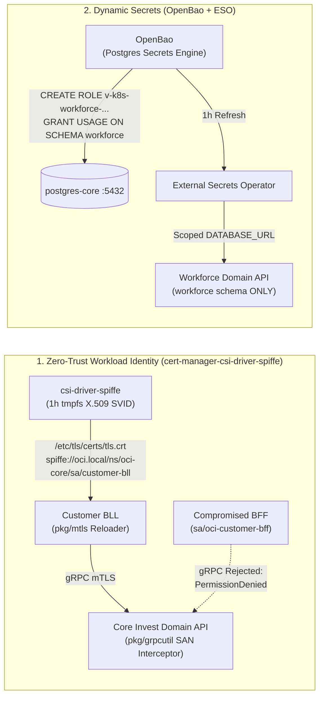

# ADR 0004: Zero-Trust Workload Identity (SPIFFE SVIDs) & Dynamic Secret Management (OpenBao + ESO)

* **Status:** Accepted
* **Date:** 2026-11-20
* **Author:** Frank Operations (`emp-human-frank`), Platform Security & K8s Infrastructure Lead & Marcus Lead (`emp-human-marcus`), Principal Systems Architect
* **Context:** Architectural specification for Roadmap Phase 5 (`7.20a`–`7.20d`): replacing static Kubernetes `Secret` credentials and unverified mTLS client certificates with cryptographically attested SPIFFE X.509 SVID workload identities (`cert-manager-csi-driver-spiffe`), gRPC URI SAN caller authorization, and short-lived dynamic secrets via OpenBao and External Secrets Operator (ESO).

---

## 1. Context and Problem Statement

Orange Cat Investments enforces inter-service mutual TLS (mTLS) across all gRPC boundaries (`BFF -> BLL -> Domain APIs`) via `cert-manager`, `trust-manager`, and `pkg/mtls` dynamic hot-reloading (`DynamicCertReloader` and `DynamicCAPoolReloader`). However, three zero-trust security gaps remain:

1. **Coarse-Grained mTLS Authentication Without Caller Identity Authorization:**
   Every microservice certificate in `oci-core` and `oci-dev` is issued by the same internal ClusterIssuer (`oci-lan-issuer` backed by `oci-lan-root-ca-key-pair`). Standard TLS client verification proves that a peer holds *a* valid certificate signed by the OCI root CA, but does not verify *which* workload is calling. If a `customer-bff` pod were compromised and network policies were misconfigured, its valid client certificate would be accepted by `core-invest-api:50053`, violating the BFF Isolation Invariant (`AGENTS.md` §3 Rule 2).
2. **Long-Lived TLS Private Keys Persisted in Kubernetes Secrets (`etcd`):**
   Currently, `cert-manager` writes issued TLS certificate/key pairs into standard Kubernetes `Secret` objects (`*-tls-certs`) mounted into pods. Even with rotation, private keys reside in cluster `etcd` storage rather than ephemeral node-local memory.
3. **Static Shared Database & Application Credentials:**
   `postgres-core`, `postgres-dev`, and `postgres-internal` rely on static passwords stored in `k8s/oci-core/oci-secrets.yaml`, `k8s/oci-dev/oci-secrets.yaml`, and `k8s/oci-internal/internal-secrets.yaml`. Furthermore, all four Domain APIs (`workforce-api`, `facilities-api`, `core-invest-api`, `ops-api`) authenticate to PostgreSQL as the same shared `oci` database user, meaning schema isolation between `workforce`, `facilities`, `core_invest`, and `ops` is enforced only by application code convention rather than PostgreSQL role permissions.

---

## 2. Decision Drivers

* **Zero Operational Duplication with Existing PKI:** Must integrate natively with our existing `cert-manager`, `trust-manager`, and `pkg/mtls` file-watching reloaders without running a parallel PKI control plane (such as a full SPIRE Server/Agent Postgres cluster).
* **Lightweight Self-Hosted Footprint:** Must run comfortably on a single-node or small multi-node MicroK8s Ubuntu Server (`thinker`) without excessive JVM or memory overhead.
* **Open-Source Licensing & Sovereign Control:** All components must be 100% open-source (MPLv2 / Apache-2.0) with no proprietary enterprise license gates.
* **Cryptographic Tier Isolation & Database Schema Enforcement:** Both gRPC RPC calls and PostgreSQL connections must enforce the 5-tier and 4-schema boundaries cryptographically.

---

## 3. Options Considered

### 3.1 Workload Identity
* **Option A: `cert-manager-csi-driver-spiffe` + `pkg/grpcutil` URI SAN Interceptor (Selected)**
  * Uses the official `cert-manager` SPIFFE CSI driver to mount short-lived (1-hour TTL) X.509 SVID certificates directly into pod `tmpfs` memory with attested `spiffe://oci.local/ns/<namespace>/sa/<service-account>` URI Subject Alternative Names (SANs), backed by the existing `oci-lan-issuer`.
  * Pairs directly with `pkg/mtls.DynamicCertReloader` (zero changes to TLS reloading logic) and a lightweight gRPC interceptor in `pkg/grpcutil` inspecting `tls.ConnectionState.PeerCertificates[0].URIs`.
* **Option B: Full CNCF SPIFFE/SPIRE Server & Agent Stack**
  * Requires deploying a separate SPIRE Server StatefulSet, datastore, and node DaemonSet alongside `cert-manager` and adapting all Go services from file-based `crypto/tls` to the SPIFFE Workload API Unix domain socket (`go-spiffe/v2`). Rejected due to unnecessary operational duplication with `cert-manager` and `trust-manager`.
* **Option C: OpenZiti Overlay Mesh**
  * Replaces standard Kubernetes networking with an overlay mesh. Rejected because Kubernetes `NetworkPolicy` microsegmentation + standard mTLS SVIDs provides equivalent security with standard Kubernetes observability.

### 3.2 Dynamic Secret Management
* **Option A: OpenBao + External Secrets Operator (ESO) (Selected)**
  * **OpenBao** (Linux Foundation MPLv2 fork of HashiCorp Vault, written in Go) provides dynamic PostgreSQL role generation (`database` secrets engine) and KV-v2 secret storage at `< 128 MiB` RAM.
  * **External Secrets Operator (ESO)** synchronizes rotated OpenBao secrets into ephemeral Kubernetes runtime secrets consumed by both custom Go workloads and third-party COTS applications (`Nextcloud`, `Forgejo`, `ZITADEL`, `Meilisearch`).
* **Option B: HashiCorp Vault (BSL License)**
  * Rejected in favor of OpenBao to maintain strictly open-source (MPLv2 / CNCF) infrastructure across the OCI stack.
* **Option C: Secrets Store CSI Driver Alone**
  * Cannot natively populate environment variables or support COTS Helm/Deployment templates expecting standard `secretKeyRef` without supplemental secret mirroring.

---

## 4. Decision Outcome & PR-Scoped Implementation Plan

We adopt **`cert-manager-csi-driver-spiffe` + gRPC SPIFFE URI SAN Verification** for Zero-Trust Workload Identity, and **OpenBao + External Secrets Operator (ESO)** for Dynamic Secret Management, executed across four incremental PR steps (`7.20a`–`7.20d`):

### Step `7.20a`: ADR 0004 & SPIFFE URI SAN Caller Authorization in `pkg/grpcutil`
1. Provision dedicated `ServiceAccount` resources per microservice (`oci-customer-bff`, `oci-employee-bff`, `oci-pebble-proxy`, `customer-bll`, `internal-bll`, `oci-worker`, `workforce-api`, `facilities-api`, `core-invest-api`, `ops-api`) in `oci-core` and `oci-dev`.
2. Encode `uris: ["spiffe://oci.local/ns/<ns>/sa/<sa>"]` on all `cert-manager` `Certificate` resources.
3. Implement `WithAllowedPeerSPIFFEIDs(allowed ...string)` unary and stream server interceptors in `pkg/grpcutil/interceptors.go`:
   * **Domain APIs (`:50051–50054`):** Allow strictly `spiffe://oci.local/ns/<ns>/sa/customer-bll`, `spiffe://oci.local/ns/<ns>/sa/internal-bll`, and `spiffe://oci.local/ns/<ns>/sa/oci-worker`. Any other caller (including BFFs or sibling Domain APIs) is rejected with `codes.PermissionDenied`.
   * **BLL APIs (`:8085–8086`):** Allow strictly `oci-customer-bff`, `oci-employee-bff`, `oci-pebble-proxy`, and `oci-worker` in the same namespace.

### Step `7.20b`: Ephemeral In-Memory SVID Mounts via `cert-manager-csi-driver-spiffe`
1. Deploy `cert-manager-csi-driver-spiffe` configured against `ClusterIssuer/oci-lan-issuer` and trust domain `oci.local`.
2. Replace static `secret:` TLS volume definitions in `k8s/oci-core/` and `k8s/oci-dev/` with ephemeral CSI inline volumes (`driver: spiffe.csi.cert-manager.io`, 1h certificate lifetime on `tmpfs`).
3. Private keys never touch `etcd`; `pkg/mtls.DynamicCertReloader` hot-reloads the rotated `/etc/tls/certs/tls.crt` files automatically.

### Step `7.20c`: OpenBao Deployment & Dynamic PostgreSQL Database Secrets Engine
1. Deploy OpenBao (`k8s/oci-core/openbao.yaml`) with Kubernetes authentication and the PostgreSQL Database Secrets Engine connected to `postgres-core`, `postgres-dev`, and `postgres-internal`.
2. Define schema-isolated dynamic role templates (24h TTL, auto-rotated):
   * `workforce-api` role: `GRANT USAGE ON SCHEMA workforce` + `SELECT, INSERT, UPDATE, DELETE ON ALL TABLES IN SCHEMA workforce` (zero privileges on `facilities`, `core_invest`, or `ops`).
   * `facilities-api` role: strictly `facilities` schema.
   * `core-invest-api` role: strictly `core_invest` schema.
   * `ops-api` role: strictly `ops` schema.
3. Update `internal/repository/` `pgxpool` initialization to support credential rotation without dropping in-flight queries.

### Step `7.20d`: External Secrets Operator (ESO) Integration & Static Secret Elimination
1. Deploy External Secrets Operator and configure `ClusterSecretStore` pointing to OpenBao.
2. Replace static `Secret` manifests (`k8s/oci-core/oci-secrets.yaml`, `k8s/oci-dev/oci-secrets.yaml`, `k8s/oci-internal/internal-secrets.yaml`) with `ExternalSecret` CRDs (`refreshInterval: 1h`).
3. Enforce a CI contract check in `scripts/verify-ci-contracts.sh` blocking raw `kind: Secret` manifests containing static credentials in workload directories.

---

## 5. Security & Operational Consequences

* **Cryptographic Tier & Schema Isolation:** Even if Kubernetes `NetworkPolicy` were completely disabled, a BFF pod cannot invoke a Domain API (rejected by `pkg/grpcutil` SPIFFE URI SAN check) and `workforce-api` cannot query `core_invest` tables (rejected by PostgreSQL role permissions `SQLSTATE 42501`).
* **Zero Private Keys in `etcd`:** All workload mTLS private keys live exclusively in node-local `tmpfs` memory with 1-hour lifetimes.
* **Automated Credential Hygiene:** Static base64 passwords are eliminated from Git history and automatically rotated on a 1h/24h schedule.
