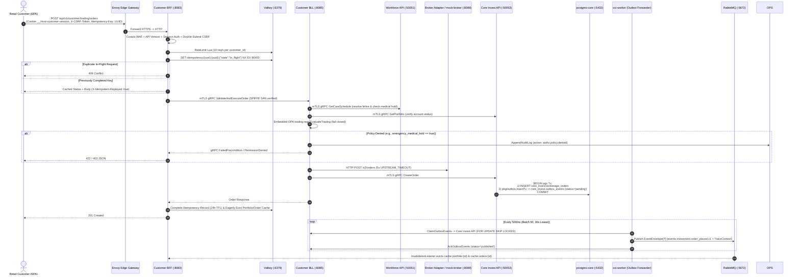
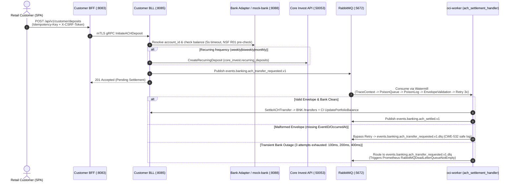
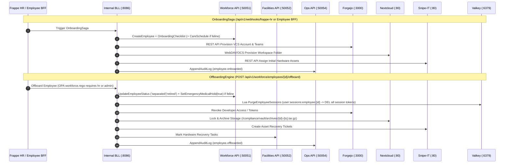

# Data Flow & Storage Lifecycle Reference

This document traces end-to-end data flows across OCI's 5-tier architecture—including synchronous request paths, transactional persistence, asynchronous outbox/event pipelines, caching, and data lifecycle/erasure rules.

---

## 1. Core End-to-End Data Flows

### 1.1 Retail Trade Order Execution & Idempotent Replay
Retail customers (`Arthur Pendelton`, `Chloe Spark`) place market or limit orders from `web/customer-portal`. Every state-changing trading request traverses edge WAF inspection, sliding-window rate limiting, atomic idempotency locking, OPA policy-as-code evaluation, bounded broker execution, transactional SQL outbox persistence, and asynchronous cache invalidation.



**Failure & Resilience Guarantees:**
* **Bounded Upstream Calls:** Broker calls use a 5-second default `UPSTREAM_TIMEOUT` (`internal/app/customerbll/upstream.go`). Broker `5xx`/timeout/422 errors map without leaking vendor names (`alpaca`) to `503`/`504`/`422`.
* **Idempotency Rollback on 5xx:** If the BFF returns `>= 500`, `IdempotencyMiddleware` deletes the Valkey lock (`store.Release`) so safe client retries can proceed.
* **Outbox Atomicity:** Because `core_invest.brokerage_orders` and `core_invest.outbox_events` commit in the same PostgreSQL transaction (`pgx.Tx`), domain events are never lost if RabbitMQ is temporarily unreachable.

---

### 1.2 Bank Account Linking & Async ACH Settlement (Retry & DLQ Flow)
Synchronous HTTP requests validate parameters, check NSF R01 balances, persist deposit/recurring schedules, and emit `events.banking.ach_transfer_requested.v1`—never blocking the browser on ACH clearing.



---

### 1.3 Feline Telemetry, WebRTC Media Relay, Device Heartbeats & Daily NAV Snapshots
1. **Computer Vision & Activity Telemetry:** Edge hardware (`mock-hardware` in `external-sim` or physical cameras) classifies feline activities (`zooming`, `napping`, `perched`, `eating`, `grooming`, `pouncing`) and emits `events.observation.cat_spotted.v1` to RabbitMQ and records confidence/event metrics (`oci.feline.behavioral_events.total`, `oci.feline.inference.confidence`). `oci-worker` consumes `cat_spotted` events (`cat_spotted_handler`) and emits `events.investment.allocation_check.v1`.
2. **Edge Device Heartbeats & Read-Time Connectivity (`7.8`–`7.9`):** Edge devices call `internal-bll.ReportDeviceHeartbeat` over mTLS gRPC every 60s (using device serials such as `QR-CAM-ORANGE-01`). `internal-bll` fans out to `facilities-api.RecordAssetHeartbeat` (updating `facilities.hardware_assets.last_ping_at`) and `core-invest-api.UpdateCameraStreamStatus` (`core_invest.camera_streams.status`). Connectivity is derived cleanly at read time via `GET /facilities/devices/connectivity` using `last_ping_at >= now() - 180s` (no background sweep cron required).
3. **WebRTC Habitat Video & `coturn` ICE Discovery (`7.39`):** Before opening a WebRTC `RTCPeerConnection` to view habitat cameras, `web/customer-portal` calls `GET /api/v1/customer/webrtc/ice-servers`. `customer-bff` computes ephemeral 1-hour HMAC-SHA1 credentials (`<expiry>:<customer_id>`, `HMAC-SHA1(TURN_AUTH_SECRET, username)`) compatible with the in-cluster `coturn` server (`--use-auth-secret` on UDP/TCP `:3478` and UDP relay range `49152–49200`).
4. **Daily NAV EOD Snapshot Batch (`7.10`–`7.11`):** On weekdays at `21:00 UTC` (`0 21 * * 1-5`), the `nav-snapshot` CronJob runs `oci-worker` with `BATCH_MODE=nav-snapshot`, calling `customer-bll.CaptureDailySnapshots`. `core-invest-api` writes idempotent rows into `core_invest.portfolio_snapshots` enforced by the partial unique index `uq_portfolio_daily_eod_snapshot`. `GET /api/v1/customer/portfolio/history?range=1M|3M|6M|1Y|YTD` reads directly from this table.

---

### 1.4 Workforce Lifecycle Sagas & COTS Integration Boundary
Workforce transitions (`OnboardingSaga` and `OffboardingEngine` in `internal/saga/`) orchestrate cross-domain state and external COTS systems via REST/WebDAV APIs while keeping COTS databases isolated in `oci-internal`:



---

### 1.5 Emergency Medical Hold & Real-Time Incident Fan-Out
1. **Emergency Medical Hold:** Only actors with `veterinary`, `vet`, or `admin` roles pass `workforce.rego` (`toggle_medical_hold`). Updating `workforce.care_schedules.emergency_medical_hold = true` emits `events.workforce.care_schedule_updated.v1` (eagerly and asynchronously evicting `cache:care_schedule:{feline_id}`) and writes an immutable entry to `ops.audit_logs`. Subsequent trade attempts fail closed in `trading.rego`.
2. **Real-Time Safety Incident Fan-Out:** Creating a workplace incident (`POST /api/v1/workforce/incidents`) persists to `workforce.incidents` + `workforce.outbox_events` and relays `events.workforce.incident_created.v1` to RabbitMQ. `oci-worker` (`HandleIncidentAlert`) deduplicates by `incident_id` and fans out simultaneously to:
   * `Internal BLL` (`BroadcastPebbleIncidentAlert`),
   * `oci-employee-bff` (`POST /api/v1/employee/incidents/broadcast` with `X-Internal-Service-Key`), which pushes live banners to connected browsers over **Server-Sent Events (`GET /api/v1/employee/incidents/stream`)**,
   * `oci-pebble-proxy` (`POST /api/v1/ops/pebble/incidents/broadcast`), surfacing vibrating alerts on on-call engineers' Pebble watches. Physical button ACKs (`POST /ops/pebble/ack`) update ticket state and record `oci.operational.pebble_mtta.duration`.

---

### 1.6 Cryptographically Signed Edge Firmware OTA Pipeline
1. **Publish:** CI or engineers upload `.bin` firmware / `.pbw` watch bundles to the **Forgejo Package Registry** via `scripts/publish-firmware-package.sh` and register metadata (including SHA-256 checksum and Ed25519/ECDSA `cosign_signature`) in `facilities.firmware_releases` via `POST /facilities/firmware`.
2. **Schedule & Relay:** Scheduling an OTA job (`POST /facilities/firmware/ota-jobs`) inserts into `facilities.device_ota_jobs` and emits `events.facilities.ota_triggered.v1` via the transactional outbox.
3. **Supply Chain Verification (`internal/app/worker/consumers_ops_workforce.go` & `cmd/mock-hardware/ota_verify.go`):**
   * `oci-worker` rewrites external `forgejo.oci.local` URLs to cluster-internal `forgejo-service.oci-internal.svc.cluster.local:3000`, downloads the artifact (64 MiB cap), verifies SHA-256 (`cosignverify.VerifySHA256Hex`), loads the public key from `ConfigMap/oci-cosign-pub` (`/etc/cosign/cosign.pub`), and verifies the cryptographic signature (`cosignverify.VerifyBlobSignature`).
   * Any checksum mismatch, missing signature, or tampered signature fails the OTA job immediately (`status = 'failed'`) and never pushes the payload to edge hardware.

---

### 1.7 GDPR Right-to-Erasure & PII Scrubbing Flow
When a customer invokes `POST /api/v1/customer/privacy/gdpr-erasure`:
1. `customer-bff` revokes all active customer sessions in Valkey (`PurgeCustomerSessions`) and invalidates portfolio/order caches.
2. `customer-bll` calls `ops-api.ScrubCustomerGDPRData` to anonymize customer PII in `ops.it_tickets` and `ops.ticket_comments`.
3. `customer-bll` calls `core-invest-api.ExecuteGDPRErasure`, which scrubs PII across `core_invest.investment_portfolios`, `core_invest.customer_api_keys`, `core_invest.webhook_subscriptions`, and `core_invest.recurring_deposits`, generating a `GDPRErasureCertificate` (`core_invest.gdpr_erasure_certificates`) containing SHA-256 hashes of the erased customer ID and email (`customer_id_hash`, `customer_email_hash`) plus a downloadable PDF certificate.
4. `customer-bll` appends an entry to `ops.audit_logs` (`action: customer.gdpr.erased`) using **only the SHA-256 `customer_id_hash`** and `certificate_id`—preserving an immutable compliance record without retaining PII.

---

## 2. Storage, Cache, Queue & Search Inventory

### 2.1 Dual PostgreSQL Architecture
OCI strictly isolates proprietary financial/operational schemas from COTS application databases across two separate PostgreSQL 16 StatefulSets:

#### A. `postgres-core` (`oci-core` / `postgres-dev` in `oci-dev`) — Database: `oci` / `oci_dev`
| Schema | Owner Service | Tables |
| :--- | :--- | :--- |
| **`workforce`** | `workforce-api` | `employees`, `onboarding_checklists`, `care_schedules`, `review_cycles`, `leave_requests`, `vhr_records`, `incidents`, `executive_reports`, `outbox_events` |
| **`facilities`** | `facilities-api` | `location_zones`, `hardware_assets`, `environmental_telemetry`, `maintenance_tickets`, `firmware_releases`, `maintenance_logs`, `device_ota_jobs`, `outbox_events` |
| **`core_invest`** | `core-invest-api` | `ml_models`, `model_drift_logs`, `customer_api_keys`, `webhook_subscriptions`, `observation_events`, `allocation_strategies`, `investment_portfolios`, `portfolio_snapshots`, `portfolio_holdings`, `tax_lot_sales`, `camera_streams`, `brokerage_orders`, `recurring_deposits`, `backtest_runs`, `investment_statements`, `gdpr_erasure_certificates`, `outbox_events` |
| **`ops`** | `ops-api` | `it_tickets`, `ticket_comments`, `outbox_events`, `audit_logs` (immutable via `trg_ops_audit_logs_no_update_delete` & `trg_ops_audit_logs_no_truncate`) |
| *ZITADEL* | `zitadel` | Dedicated ZITADEL IAM tables inside `postgres-core`. |

#### B. `postgres-internal` (`oci-internal`)
Dedicated independent databases for COTS tools: `forgejo`, `nextcloud`, `snipeit`, `erpnext`, and `frappe_hr` (using unprivileged per-app DB roles).

#### C. Three-Copy SQL & Migration Protocol
Per [`scripts/migrations/README.md`](../../scripts/migrations/README.md):
1. Bootstrap DDL lives in **three synchronized copies**: [`scripts/init.sql`](../../scripts/init.sql), `k8s/oci-core/postgres-core-configmap.yaml`, and `k8s/oci-dev/postgres-dev-configmap.yaml` (dev fixtures in [`scripts/seed-dev.sql`](../../scripts/seed-dev.sql) and `oci-dev` ConfigMap).
2. Because bootstrap scripts run only on empty volumes, all schema changes are idempotent and also shipped as numbered files in [`scripts/migrations/`](../../scripts/migrations/) (`001-portfolio-snapshot-daily-nav.sql`, `002-firmware-cosign-signature.sql`, `002-monitoring-role.sql`, `003-transactional-outbox.sql`, `004-tamper-evident-audit-log.sql`).

---

### 2.2 Valkey Distributed Store (`valkey-service.oci-core.svc.cluster.local:6379`)
Persisted with `--appendonly yes` on `valkey-data-pvc`. All Go packages fall back gracefully to thread-safe in-memory stores during offline unit testing.

| Key Pattern | Package | TTL | Purpose & Invalidation |
| :--- | :--- | :--- | :--- |
| `session:customer:{token}` | `pkg/session/valkey` | `24h` | Opaque customer session payload (`CustomerSession`). |
| `user:sessions:customer:{id}` | `pkg/session/valkey` | `48h` | Redis Set enabling atomic multi-device logout / GDPR purge via Lua. |
| `session:employee:{token}` | `pkg/session/valkey` | `24h` | Opaque employee session payload (`EmployeeSession` with role & department). |
| `user:sessions:employee:{id}` | `pkg/session/valkey` | `48h` | Redis Set enabling atomic `OffboardingEngine` revocation via Lua. |
| `idempotency:{customer_id}:{uuid}` | `pkg/cache/valkey` | `24h` | Atomic `SET NX EX 86400` lock + deterministic HTTP response replay cache. |
| `ratelimit:{scope}:{id_or_ip}` | `pkg/cache/valkey` | Window + `1s` | Sorted-set (`ZREMRANGEBYSCORE`, `ZCARD`, `ZADD`) sliding-window limiter. |
| `cache:portfolio:{cust}[:{port}]` | `pkg/cache/valkey` | `30s` | Portfolio valuation bytes + SHA-256 `ETag`. Evicted eagerly & on `order_placed`/`trade_executed`. |
| `cache:orders:{cust}` | `pkg/cache/valkey` | `30s` | Customer order history cache. Evicted on trade/order events. |
| `cache:quotes:{symbol}` | `pkg/cache/valkey` | `5s` | Market quote snapshot. |
| `cache:habitat:telemetry` | `pkg/cache/valkey` | `5s` | Environmental sensor summary. |
| `cache:esg:metrics` | `pkg/cache/valkey` | `15m` | Feline welfare & ESG transparency metrics. |
| `cache:care_schedule:{feline}` | `pkg/cache/valkey` | `2m` | Feline dietary/hold state. Evicted eagerly & on `care_schedule_updated`. |
| `cache:cots:{snipeit\|forgejo\|frappe}:*` | `pkg/cache/valkey` | `60s` | COTS metadata cache. |
| `cache:ops:active_incidents` | `pkg/cache/valkey` | `30s` | Active incident list. Evicted on `incident_created`. |

---

### 2.3 RabbitMQ Event Bus (`rabbitmq-service.oci-core.svc.cluster.local:5672`)
All domain messages use [`envelope.EventEnvelope[T]`](../../pkg/envelope/envelope.go):
```json
{
  "event_id": "019...",
  "event_type": "events.investment.order_placed.v1",
  "occurred_at": "2026-11-24T14:30:00Z",
  "correlation_id": "<otel-trace-or-request-id>",
  "payload": { }
}
```
W3C Trace Context (`traceparent` / `tracestate`) is injected into Watermill `message.Metadata` by `pkg/envelope.InjectTraceContext` and extracted by `TraceContextMiddleware` in `oci-worker`.

| Topic | Producer | Consumer(s) | Dead-Letter Queue |
| :--- | :--- | :--- | :--- |
| `events.observation.cat_spotted.v1` | `mock-hardware` / Vision Pipeline | `oci-worker` (`cat_spotted_handler`) | `events.observation.cat_spotted.v1.dlq` |
| `events.investment.allocation_check.v1` | `oci-worker` | Allocation pipeline | — |
| `events.investment.order_placed.v1` | `core-invest-api` (Outbox) / `customer-bll` | BFF `InvalidationListener` | — |
| `events.investment.trade_executed.v1` | `core-invest-api` / Broker fill | BFF `InvalidationListener` | — |
| `events.investment.backtest_requested.v1` | `customer-bll` | `oci-worker` (`backtest_run_handler`) | `events.investment.backtest_requested.v1.dlq` |
| `events.investment.backtest_completed.v1` | `oci-worker` | Backtest notification subscribers | — |
| `events.banking.ach_transfer_requested.v1` | `customer-bll` / `recurring-ach-processor` | `oci-worker` (`ach_settlement_handler`) | `events.banking.ach_transfer_requested.v1.dlq` |
| `events.banking.ach_settled.v1` | `oci-worker` | Portfolio balance / notification subscribers | — |
| `events.facilities.ota_triggered.v1` | `facilities-api` (Outbox) / `internal-bll` | `oci-worker` (`ota_pipeline_handler`) | `events.facilities.ota_triggered.v1.dlq` |
| `events.facilities.ota_completed.v1` | `oci-worker` | OTA status listeners | — |
| `events.workforce.incident_created.v1` | `workforce-api` (Outbox) / `internal-bll` | `oci-worker` (`incident_alert_pipeline_handler`) + `InvalidationListener` | `events.workforce.incident_created.v1.dlq` |
| `events.workforce.care_schedule_updated.v1` | `workforce-api` (Outbox) | BFF `InvalidationListener` | — |
| `events.reporting.generate_monthly_requested.v1` | Reporting trigger | `oci-worker` (`executive_reporting_trigger_handler`) | `events.reporting.generate_monthly_requested.v1.dlq` |
| `events.reporting.report_generated.v1` | `oci-worker` | Executive BI listeners | — |
| `events.reporting.statements_generated.v1` | `eom-statement-generator` | Statement notification listeners | — |
| `events.ops.ca_rotated.v1` | `oci-worker` (`CARotationManager`) | Ops audit & alerting | — |

---

### 2.4 Meilisearch Full-Text Search (`meilisearch-service.oci-core.svc.cluster.local:7700`)
* **Employee Search (`employee_knowledge` index):** Queried via `GET /api/v1/employee/search` (Powers the `⌘K` palette in `web/employee-portal` across VHRs, IT tickets, SOPs, and hardware assets).
* **Customer Search:** Queried via `GET /api/v1/customer/search` across funds, tickers, ESG welfare metrics, and tax statements.
* **Data Lifecycle:** Protected by `MEILI_MASTER_KEY` (via OpenBao/ESO) and scrubbed during GDPR erasure.
