# Security, Compliance & Audit Reference

This document provides auditors, security engineers, and new staff with a complete map of Orange Cat Investments' (OCI) defense-in-depth controls, cryptographic guarantees, compliance mappings, and verifiable evidence commands.

---

## 1. Defense-in-Depth Control Architecture

```mermaid
flowchart LR
    C["Client Browser / App"] -->|"TLS 1.3 + Security Headers"| GW["1. Edge Gateway\n(Envoy Gateway API + CIDR SecurityPolicy)"]
    GW -->|"HTTP Inspection"| WAF["2. Coraza OWASP CRS WAF\n+ Sliding Rate Limiter + Idempotency"]
    WAF -->|"Opaque __Host-* Cookie + CSRF"| BFF["3. BFF Auth Termination\n(ZITADEL OIDC / Forgejo OAuth2 + Valkey)"]
    BFF -->|"1h SPIFFE SVID mTLS + Actor MD"| BLL["4. BLL Policy Enforcement\n(Embedded OPA / Rego v1)"]
    BLL -->|"1h SPIFFE SVID mTLS (SAN Allowlist)"| DAPI["5. Domain APIs\n(Default-Deny NetworkPolicy)"]
    DAPI -->|"24h Dynamic Schema-Scoped Role"| DB[("6. postgres-core\n+ Transactional Outbox\n+ SHA-256 ops.audit_logs")]
```

---

## 2. Authentication, Session Custody & Edge Defenses

### 2.1 Strict Dual-Identity Separation
* **External Retail Customers (`ZITADEL` OIDC):** Strictly reserved for `web/customer-portal` and `cmd/customer-bff`. OIDC tokens are exchanged server-side and never sent to browser `localStorage` or `sessionStorage`.
* **Internal Employees & Feline Staff (`Forgejo` OAuth2):** Strictly reserved for `web/employee-portal` and `cmd/employee-bff`. Roles (`hr`, `veterinary`, `engineering`, `investment`, `ops`, `facilities`, `manager`, `admin`) and departments map from Forgejo/workforce records into server-side `EmployeeSession` structs.
* **Opaque Browser Cookies:** Clients receive only `__Host-customer-session` or `__Host-employee-session` (`HttpOnly`, `Secure`, `SameSite=Lax`). All session tokens live in Valkey (`session:customer:{token}`, `session:employee:{token}`, 24h TTL) alongside per-user index sets (`user:sessions:*`) enabling atomic multi-device revocation via Lua (`PurgeCustomerSessions`, `PurgeEmployeeSessions`) on logout, offboarding, or GDPR erasure.
* **Double-Submit CSRF Protection:** Every `POST`, `PUT`, `PATCH`, and `DELETE` endpoint on both BFFs validates `X-CSRF-Token` against the `csrf_token` cookie (`pkg/session/middleware.go`).

### 2.2 Coraza OWASP CRS WAF (`pkg/waf/coraza.go`)
Attached to both `customer-bff` and `employee-bff` Chi routers (`waf.Middleware(waf.DefaultConfig())`), inspecting URI, decoded query args, headers (`User-Agent`, `Referer`, `X-Forwarded-For`, `X-Original-URL`), and JSON/form bodies up to `1 MiB`:
* **930xxx:** Path Traversal & LFI (`/etc/passwd`, `../`, `%2e%2e`)
* **932xxx:** Remote Command Execution / Shell Injection
* **941xxx:** Cross-Site Scripting (`<script>`, inline `on*=`, `javascript:`, `<iframe>`, `<svg>`)
* **942xxx:** SQL Injection (tautologies, `UNION SELECT`, stacked queries, `pg_sleep`/`information_schema`)
* **Telemetry & Hygiene:** Blocks return `HTTP 403` (`WAF_RULE_VIOLATION`), increment `oci.waf.blocked_requests.total`, and log rule metadata **without logging raw exploit strings or sensitive request bodies** (CWE-532).

### 2.3 Distributed Sliding-Window Rate Limiting (`pkg/cache/valkey/ratelimit.go`)
Atomic Lua script (`ZREMRANGEBYSCORE`, `ZCARD`, `ZADD`, `EXPIRE`) returning `X-RateLimit-Limit`, `X-RateLimit-Remaining`, and `Retry-After` (`HTTP 429`):
* Customer login: `5 req / 15m` per client IP (`customer_login:{ip}`)
* Customer orders: `10 req / 1s` per `customer_id` (`customer_orders:{id}`)
* Customer deposits: `5 req / 15m` per client IP (`customer_deposits:{ip}`)
* Pebble Watch ACKs: `10 req / 1m`
* **Environment Guard (CI Check #11):** `RATE_LIMIT_ENABLED=false` is permitted strictly in `k8s/oci-dev/` and forbidden in `k8s/oci-core/`.

### 2.4 Edge Gateway & WebRTC Media Security
* **Kubernetes Gateway API v1 ([`gateway.yaml`](../../k8s/ha/lan/tls/gateway.yaml)):** Terminates TLS (`oci-core-lan-tls`, `oci-marketing-tls`, `oci-dev-lan-tls`, `oci-sim-lan-tls`) via Envoy Gateway (`v1.2.4`) and attaches `SecurityPolicy` CIDR allowlists (e.g. RFC 1918 restriction on `longhorn.oci.local`).
* **STUN/TURN (`coturn`):** Uses `--use-auth-secret` so `customer-bff` issues short-lived (1h) HMAC-SHA1 ephemeral TURN credentials via `/api/v1/customer/webrtc/ice-servers` rather than static media relay passwords.

---

## 3. Policy-as-Code Authorization (Embedded OPA / Rego)

OCI evaluates high-sensitivity authorization rules deterministically inside the BLL tier using the embedded Open Policy Agent Rego v1 SDK ([`pkg/authz/policy/engine.go`](../../pkg/authz/policy/engine.go)):

1. **Authenticated Actor Propagation ([`pkg/grpcutil/actor.go`](../../pkg/grpcutil/actor.go)):** BFFs attach `x-oci-actor-id`, `x-oci-actor-role`, and `x-oci-actor-dept` metadata to outgoing mTLS gRPC calls.
2. **Workforce Policy ([`workforce.rego`](../../pkg/authz/policy/policies/workforce.rego)):**
   * `toggle_medical_hold` & `submit_vet_audit`: Strictly `veterinary`, `vet`, or `admin`.
   * `offboard_employee`: Strictly `hr` or `admin`.
   * `approve_leave` & `submit_manager_assessment`: Enforces role requirements **plus anti-self-approval** (`not self_target` for non-admin roles).
   * `manage_review_cycle`: `hr`, `admin`, `manager`, or `veterinary`.
3. **Trading Pre-Trade Policy ([`trading.rego`](../../pkg/authz/policy/policies/trading.rego)):**
   * Blocks orders on `closed`, `suspended`, `frozen`, or `erased` accounts.
   * **Fail-Closed Feline Medical Hold:** Halts algorithmic orders whenever `feline.emergency_medical_hold == true` (unless `risk_override`/`admin`).
   * Enforces strictly positive quantities, valid sides (`buy`|`sell`), single-order notional caps (`$250,000` default), and buying-power sufficiency.
4. **Fail-Closed & Audited Denials:** Missing actor context or uninitialized policy engines deny by default, and every denial appends an `authz.policy.denied` record to `ops.audit_logs`.

---

## 4. Zero-Trust Workload Identity, mTLS & Dynamic Secrets

### 4.1 Ephemeral SPIFFE X.509-SVIDs (`cert-manager-csi-driver-spiffe`)
* Every custom microservice runs under a dedicated `ServiceAccount` (`oci-customer-bff`, `oci-employee-bff`, `oci-pebble-proxy`, `customer-bll`, `internal-bll`, `oci-worker`, `workforce-api`, `facilities-api`, `core-invest-api`, `ops-api`, `mock-hardware`).
* `cert-manager-csi-driver-spiffe` mounts **1-hour TTL** X.509-SVID certificates directly into node-local `tmpfs` at `/etc/tls/certs` (`fs-group: "65532"`). **TLS private keys never touch Kubernetes `etcd` Secrets**, and `subPath` mounts on TLS/CA paths are blocked by Kyverno (`forbid-tls-subpath-mounts`).
* `pkg/mtls.DynamicCertReloader` and `DynamicCAPoolReloader` watch file timestamps on `/etc/tls/certs` and `/etc/tls/ca/ca.crt` (synced across namespaces by `trust-manager` `Bundle/oci-ca-bundle`) and hot-swap certificates in memory via `crypto/tls` callbacks with zero connection drops.
* `internal/service/pki.CARotationManager` checks intermediate CA validity hourly and automates renewal 30 days before expiry.

### 4.2 gRPC SPIFFE URI SAN Caller Authorization (`pkg/grpcutil/interceptors.go`)
Every gRPC server extracts `PeerCertificates[0].URIs` (`spiffe://oci.local/ns/<ns>/sa/<sa>`) in both unary and stream interceptors:
* **Domain APIs (`:50051–50054`):** Permit strictly `customer-bll`, `internal-bll`, and `oci-worker` in the same namespace.
* **Customer BLL (`:8085`):** Permits strictly `oci-customer-bff` and `oci-worker`.
* **Internal BLL (`:8086`):** Permits strictly `oci-employee-bff`, `oci-pebble-proxy`, `oci-worker`, and `external-sim/sa/mock-hardware` (or `mock-hardware-dev` in `oci-dev`).

### 4.3 OpenBao Dynamic Database Roles & ESO (`scripts/init-openbao.sh`)
* **OpenBao (`2.1.0`)** in `oci-core` manages KV-v2 secrets (`secret/oci-core/config`, `secret/oci-dev/config`, `secret/oci-internal/config`, `secret/oci-core/cosign`) and the PostgreSQL Database Secrets Engine.
* **External Secrets Operator (ESO)** reconciles `ExternalSecret` and `VaultDynamicSecret` manifests (`refreshInterval: 1h`) into runtime secrets. Static `kind: Secret` credential manifests are prohibited in `k8s/oci-core/`, `k8s/oci-dev/`, and `k8s/oci-internal/` (CI Check #18).
* **Schema-Scoped 24h Dynamic Roles:** Each Domain API receives ephemeral PostgreSQL credentials (`default_ttl=24h`, `max_ttl=48h`) granted `USAGE/SELECT/INSERT/UPDATE/DELETE` strictly on its own schema and explicit `REVOKE ALL PRIVILEGES` on the other 3 schemas. [`pkg/dbpool`](../../pkg/dbpool/dbpool.go) reloads credential files in `BeforeConnect` with `MaxConnLifetime = 30m`.

---

## 5. Network Microsegmentation (`NetworkPolicy` Matrix)

Every workload namespace (`oci-core`, `oci-dev`, `oci-internal`, `external-sim`) deploys `default-deny-all` (`policyTypes: [Ingress, Egress]`, `podSelector: {}`) plus explicit L3/L4 allowlists:

| Source Tier / Pod | Allowed Egress Targets & Ports | Explicitly Denied Paths |
| :--- | :--- | :--- |
| **Global (all pods)** | `kube-system/kube-dns:53`, `monitoring:4317,4318,9090` | All lateral traffic unless explicitly allowed |
| **Tier 2 (`tier: bff`)** | `tier: bll` (`:8085,:8086`), `valkey:6379`, `rabbitmq:5672`, `meilisearch:7700`, `zitadel:8080`, `oci-internal` (`:80,:3000,:8000`) | **Zero egress to `postgres-core:5432` or `domain-api:50051–50054`** |
| **Tier 3 (`tier: bll`)** | `tier: domain-api` (`:50051–50054`), `rabbitmq:5672`, `meilisearch:7700`, `oci-internal` (`:80,:3000,:8000`), `external-sim/mock-bank:8088`, `external-sim/mock-broker:8089` | Zero direct egress to `postgres-core:5432` |
| **Tier 4 (`tier: domain-api`)** | **`postgres-core:5432` ONLY** (and `postgres-dev:5432` in `oci-dev`) | **Zero east-west egress to sibling Domain APIs, BLLs, internet, or COTS** |
| **Tier 5 (`oci-worker` / `batch`)** | `tier: bll` (`:8085,:8086`), `tier: bff` (`:8081,:8082`), `rabbitmq:5672`, `oci-internal/forgejo:3000` | Zero direct DB `:5432` egress |
| **`external-sim` (`mock-bank`, `mock-broker`)** | DNS & OTel telemetry only (`egress: []` beyond global policy) | **Zero egress to any PostgreSQL `:5432`** |

---

## 6. Software Supply Chain & Runtime Hardening

1. **Pre-Build SAST, Linting & Secret Scanning:**
   * `.semgrep.yml` (7 architectural invariant rules), `.golangci.yml` (v2 with `gosec`), `govulncheck ./...`, and `gitleaks detect --config .gitleaks.toml`.
2. **Distroless Runtime & Restricted PSS:**
   * All 14 Go/Hugo Dockerfiles build statically linked binaries onto `gcr.io/distroless/static-debian12:nonroot` (`USER nonroot:nonroot`).
   * All Go pods in `oci-core`, `oci-dev`, and `external-sim` enforce `runAsNonRoot: true`, `runAsUser: 65532`, `readOnlyRootFilesystem: true`, `allowPrivilegeEscalation: false`, `capabilities.drop: ["ALL"]` (CI Check #20).
3. **Harbor Registry, Trivy, Syft SBOMs & Cosign Signing:**
   * Harbor ([`harbor.yaml`](../../k8s/registry/harbor.yaml)) hosts images on `:32000` / `registry.oci.local` with Forgejo OIDC and pull-through proxy caches.
   * Forgejo Actions blocks builds with `trivy image --exit-code 1 --severity CRITICAL,HIGH`, generates CycloneDX SBOMs via `syft`, and signs & attests images with `cosign sign` and `cosign attest`.
   * Firmware binaries uploaded to Forgejo Packages are signed with Cosign and verified by `pkg/cosignverify` before OTA rollout.
4. **Kyverno Cluster Admission Control ([`kyverno-policies.yaml`](../../k8s/security/kyverno-policies.yaml)):**
   Four `Enforce` `ClusterPolicy` rules validated against negative fixtures ([`invalid-manifests.yaml`](../../k8s/security/fixtures/invalid-manifests.yaml)):
   * `verify-oci-image-signatures` (Cosign key verification on `localhost:32000/*` in `oci-core`)
   * `disallow-latest-tag` (Prohibits `:latest` and `:dev-latest` in `oci-core`)
   * `enforce-restricted-pss` (Restricted securityContext across `oci-core` and `oci-dev` Go workloads)
   * `forbid-tls-subpath-mounts` (Rejects `subPath` on TLS/CA mounts)

---

## 7. Tamper-Evident Audit Trail & Log Hygiene

### 7.1 Cryptographic Hash-Chain Audit Log (`ops.audit_logs`)
Implemented in [`004-tamper-evident-audit-log.sql`](../../scripts/migrations/004-tamper-evident-audit-log.sql) and [`internal/repository/ops/audit.go`](../../internal/repository/ops/audit.go):
* **Database-Level Immutability:** PostgreSQL triggers (`trg_ops_audit_logs_no_update_delete`, `trg_ops_audit_logs_no_truncate`) raise `SQLSTATE 42501` on any `UPDATE`, `DELETE`, or `TRUNCATE` attempt.
* **Serialized Hash Chaining:** A `BEFORE INSERT` trigger acquires `pg_advisory_xact_lock(741001)`, reads the latest `record_hash` (or `'GENESIS'`), and computes:
  `SHA256(previous_hash|actor_id|actor_role|action|resource_type|resource_id|metadata_json|YYYY-MM-DDTHH24:MI:SS.USZ)`.
* **Audited Sensitive Operations:** Emergency medical holds, employee offboarding, leave status approvals, quant/automated trade orders, customer API key revocations, OPA policy denials (`authz.policy.denied`), and GDPR erasures (recording only SHA-256 `customer_id_hash`).
* **Auditor Verification Endpoint:** `GET /api/v1/ops/audit-logs/verify` (session-authenticated on `employee-bff`) walks the entire chain in `id ASC` order, recomputing every SHA-256 link and reporting `valid`, `verified_records`, `latest_hash`, or exact `broken_at_id`.

### 7.2 CWE-532 Sensitive Payload Hygiene
HTTP handlers, WAF middleware, Watermill poison-queue logging (`poison_middleware.go`), and OpenBao startup paths log strictly metadata (`event_id`, `topic`, `correlation_id`, `rule_id`, `error`)—never raw message bodies, exploit payloads, passwords, or OIDC tokens.

---

## 8. Compliance Framework Mapping & Auditor Verification Matrix

### 8.1 Framework Alignment
| Framework / Standard | Control Area | OCI Implementation & Evidence |
| :--- | :--- | :--- |
| **SOC 2 (CC6.1, CC6.6, CC6.7, CC7.2, CC8.1)** | Logical access, network segmentation, encryption in transit, change management, monitoring | Dual-IdP + Valkey sessions, OPA/Rego RBAC, SPIFFE 1h SVID mTLS, default-deny `NetworkPolicy`, Forgejo PR + `oci-dev` sim gate + Kyverno immutability, Prometheus/Loki/Gatus. |
| **ISO/IEC 27001 (A.8, A.9, A.12, A.14)** | Cryptography, access control, operations security, secure SDLC | OpenBao dynamic DB roles, Cosign + Trivy + Syft SBOMs, Distroless non-root containers, `.semgrep.yml` + `gitleaks` + `govulncheck`, runbooks in `docs/runbooks/`. |
| **SEC / FINRA Recordkeeping & Pre-Trade Risk** | Immutable audit logs, pre-trade risk controls, duplicate order protection | `ops.audit_logs` hash chain + DB mutation triggers, `trading.rego` notional/buying-power/medical-hold checks, Valkey `Idempotency-Key`, 1099-B & EOM statement generation. |
| **GDPR (Art. 17, Art. 25, Art. 32)** | Right to erasure, data protection by design, security of processing | `ExecuteGDPRErasure` scrubbing across `core_invest` & `ops`, `GDPRErasureCertificate` PDF, Valkey session purge, hashed non-PII `ops.audit_logs` entry. |

### 8.2 Auditor Verification Commands
Auditors can independently verify every technical control offline (against Git) or live (against `oci-dev` / `oci-core`):

| Control | Verification Command / Target |
| :--- | :--- |
| **All 31 CI Architectural & Security Contracts** | `./scripts/verify-ci-contracts.sh` |
| **SAST, Linter, Vuln & Secret Scanners** | `semgrep --config .semgrep.yml --error && go vet ./... && go test -race ./... && golangci-lint run && govulncheck ./... && gitleaks detect --config .gitleaks.toml` |
| **Kyverno Admission Policy Validation** | `kyverno apply k8s/security/kyverno-policies.yaml --resource k8s/oci-core/` and negative test against `k8s/security/fixtures/invalid-manifests.yaml` |
| **Tamper-Evident Audit Chain Integrity** | Authenticated `GET /api/v1/ops/audit-logs/verify` on Employee BFF (or simulator action `frank_verify_audit_chain`) |
| **WAF, OPA Policy Denial, Gateway & Idempotency** | `frank_waf_security_audit`, `rick_unauthorized_medical_hold_denied`, `frank_audit_gateway_routes`, `chloe_idempotent_order_replay` in `simulation/` |
| **Immutable Production Images** | `./scripts/verify-deployed-images.sh oci-core sha-<COMMIT>` |
