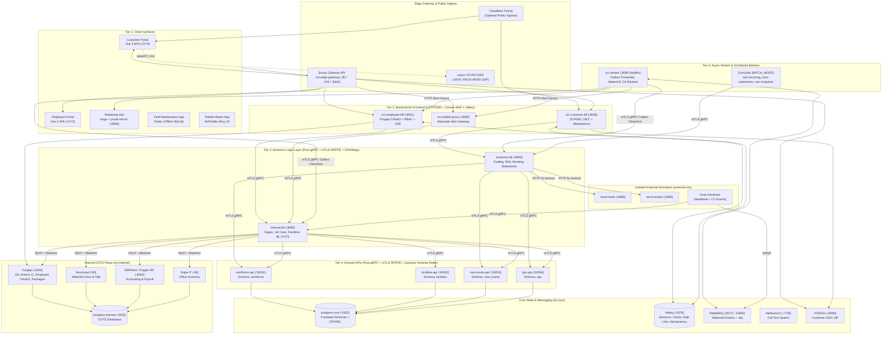

# System Architecture Reference

This document describes the production software and systems architecture of **Orange Cat Investments (OCI)**—a self-hosted, domain-driven, 5-tier platform running on **MicroK8s (Ubuntu Server)**.

---

## 1. Architectural Overview & 5-Tier Topology

OCI enforces strict separation between client presentation, session termination, business orchestration, relational domain persistence, and asynchronous execution:

---

## 2. Four-Layer Architectural Boundary Enforcement

Architectural invariants defined in [`AGENTS.md`](../../AGENTS.md) §3 are not merely conventions—they are enforced simultaneously at **four independent technical layers**:

| Invariant | Layer 1: Static Analysis (`.semgrep.yml`) | Layer 2: Application / gRPC (`pkg/grpcutil`, `pkg/dbpool`) | Layer 3: Kubernetes `NetworkPolicy` (`k8s/*/network-policies.yaml`) | Layer 4: PostgreSQL / OpenBao (`scripts/init-openbao.sh`) |
| :--- | :--- | :--- | :--- | :--- |
| **BFFs never touch DBs or Domain APIs** | `oci-bff-no-direct-db-or-domain-import` blocks `pgxpool` and `workforce`/`facilities`/`core_invest`/`ops` imports in `cmd/*-bff` and `internal/app/*bff`. | Domain APIs reject BFF SPIFFE IDs (`AllowedDomainAPICallers` permits only `customer-bll`, `internal-bll`, `oci-worker`). | `bff-tier-network-policy` denies egress from `tier: bff` to `:5432` and `:50051–50054` (enforced by CI Check #25). | BFF pods receive zero database credentials or `VaultDynamicSecret` mounts. |
| **Domain APIs never call each other** | `oci-*-api-no-cross-domain-import` blocks cross-domain imports in each `cmd/*-api`. | `AllowedDomainAPICallers` omits sibling Domain API ServiceAccounts. | `domain-apis-network-policy` limits `tier: domain-api` ingress strictly to `tier: bll` and egress strictly to `postgres-core:5432`. | OpenBao issues per-schema dynamic Postgres roles that `REVOKE ALL PRIVILEGES` on the other 3 schemas. |
| **Vendor isolation (`alpaca`/`plaid`)** | `oci-no-vendor-identifiers-outside-drivers` restricts vendor names to `pkg/broker/alpaca`, `pkg/bank/plaid`, `cmd/mock-*`, `simulation`. | `customerbll` sanitizes error strings via `sanitizeVendorNames` before returning gRPC/HTTP errors. | `external-sim` mocks are isolated to their own namespace with zero DB egress. | N/A |
| **Zero hardcoded entities in `oci-core`** | `oci-no-hardcoded-persona-ids` blocks `emp-*` and `cust-*` literals in `cmd/`, `internal/`, `pkg/`. | Context extraction (`CustomerFromContext`, `EmployeeFromContext`) and dynamic DB lookups. | `verify-ci-contracts.sh` ensures `-dev` mocks never wire to `oci-core` and vice versa. | Production `scripts/init.sql` seeds only `admin@oci.local`; mock personas live strictly in `scripts/seed-dev.sql`. |

---

## 3. Complete Service & Component Catalog

### 3.1 Tier 1: Client Applications
| Component | Path | Port / Host (`oci-core`) | Technology & Auth | Purpose |
| :--- | :--- | :--- | :--- | :--- |
| **Customer Web Portal** | [`web/customer-portal`](../../web/customer-portal) | `:5174` / `customer.oci.local` | Vue 3 SPA (Vite + nginx/static); ZITADEL OIDC via Customer BFF | Portfolio valuation & `1M..YTD` history, WebRTC habitat video player, active trading terminal, Zoomie Index, ACH deposits, ESG dashboard, statements, GDPR erasure. |
| **Employee Web Portal** | [`web/employee-portal`](../../web/employee-portal) | `:5173` / `employee.oci.local` | Vue 3 SPA; Forgejo OAuth2 via Employee BFF | Feline care schedules, emergency medical trading holds, clinical VHR charting, leave requests, performance review cycles, `⌘K` Meilisearch palette, SSE incident banners, COTS launcher. |
| **Marketing Website** | [`web/marketing`](../../web/marketing) + [`cmd/portal-server`](../../cmd/portal-server) | `:8080` (`Service: 80`) / `oci.local` | Hugo static site served by Go distroless `portal-server` with `/healthz` | Public landing site. |
| **Field Maintenance App** | [`mobile/flutter_app`](../../mobile/flutter_app) | API via `api.oci.local` | Flutter SDK + `sqflite` offline SQLite sync | QR code asset scanning (`QR-CAM-*`), offline maintenance logs, batch sync to Employee BFF. |
| **Pebble Watch App** | [`embedded/pebble`](../../embedded/pebble) | Gateway via `pebble-proxy.oci.local` | RePebble Alloy (Moddable XS Embedded JS + C bootstrap + PKJS) | On-call alert notifications and physical button ACKs via `oci-pebble-proxy`. |

### 3.2 Tier 2: Backend-for-Frontend (BFF) & Wearable Gateway
All Tier 2 services expose plaintext HTTP `/healthz` probes, enforce Coraza OWASP CRS WAF (`pkg/waf`), enforce API versioning headers (`pkg/versioning`), run as `UID 65532` distroless non-root containers, and mount 1-hour `tmpfs` SPIFFE X.509-SVIDs.

| Service | Entrypoint & App Package | Port | ServiceAccount / SPIFFE ID (`oci-core`) | Downstream BLL | Key Responsibilities |
| :--- | :--- | :--- | :--- | :--- | :--- |
| **Customer BFF** | [`cmd/customer-bff`](../../cmd/customer-bff) → [`internal/app/customerbff`](../../internal/app/customerbff) | `:8083` | `spiffe://oci.local/ns/oci-core/sa/oci-customer-bff` | `customer-bll:8085` | ZITADEL OIDC sessions (`__Host-customer-session` in Valkey), double-submit CSRF, sliding-window rate limits, Valkey `Idempotency-Key` middleware, ETag cache-aside, SSE ticker, `coturn` ICE credentials. |
| **Employee BFF** | [`cmd/employee-bff`](../../cmd/employee-bff) → [`internal/app/employeebff`](../../internal/app/employeebff) | `:8081` | `spiffe://oci.local/ns/oci-core/sa/oci-employee-bff` | `internal-bll:8086` | Forgejo OAuth2 sessions (`__Host-employee-session` in Valkey), role-based access control (`rbac.go`), SSE incident stream hub, Meilisearch `⌘K` queries, COTS & workforce/facilities routes. |
| **Pebble Proxy** | [`cmd/pebble-proxy`](../../cmd/pebble-proxy) | `:8082` | `spiffe://oci.local/ns/oci-core/sa/oci-pebble-proxy` | `internal-bll:8086` | Translates active IT tickets & safety incidents to Pebble AppMessage payloads (`/ops/pebble/alerts`), ingests watch ACKs (`/ops/pebble/ack`), records `oci.operational.pebble_mtta.duration`. |

### 3.3 Tier 3: Business Logic Layer (BLL)
Pure mTLS gRPC servers using `grpc.health.v1` and `tcpSocket` probes, enforcing SPIFFE URI SAN caller allowlists (`pkg/grpcutil/interceptors.go`) and embedded OPA/Rego policies (`pkg/authz/policy`).

| Service | Entrypoint & App Package | Port | Allowed SPIFFE Callers (`oci-core`) | Downstream Dependencies |
| :--- | :--- | :--- | :--- | :--- |
| **Customer BLL** | [`cmd/customer-bll`](../../cmd/customer-bll) → [`internal/app/customerbll`](../../internal/app/customerbll) | `:8085` | `oci-customer-bff`, `oci-worker` | `core-invest-api`, `workforce-api`, `ops-api`, `mock-broker` (5s timeout), `mock-bank` (5s timeout), RabbitMQ, OPA `trading.rego`. |
| **Internal BLL** | [`cmd/internal-bll`](../../cmd/internal-bll) → [`internal/app/internalbll`](../../internal/app/internalbll) | `:8086` | `oci-employee-bff`, `oci-pebble-proxy`, `oci-worker`, `external-sim/sa/mock-hardware` | `workforce-api`, `facilities-api`, `core-invest-api`, `ops-api`, Forgejo, Nextcloud WebDAV, Frappe HR, Snipe-IT, Meilisearch, RabbitMQ, OPA `workforce.rego`. |

### 3.4 Tier 4: Domain APIs (gRPC over Schema-Isolated PostgreSQL)
Pure mTLS gRPC servers backed by `pkg/dbpool` (file-reloaded dynamic OpenBao credentials, 30m `MaxConnLifetime`) and `pkg/outbox` transactional outbox writes.

| Service | Entrypoint | Port | Owned Schema | Allowed SPIFFE Callers | Primary Domain Responsibilities |
| :--- | :--- | :--- | :--- | :--- | :--- |
| **Workforce API** | [`cmd/workforce-api`](../../cmd/workforce-api) | `:50051` | `workforce` | `customer-bll`, `internal-bll`, `oci-worker` | Human & feline employee directory, onboarding checklists, feline care schedules & medical holds, review cycles, leave requests, VHR clinical records, incidents, executive reports. |
| **Facilities API** | [`cmd/facilities-api`](../../cmd/facilities-api) | `:50052` | `facilities` | `customer-bll`, `internal-bll`, `oci-worker` | Location zones, keyset-paginated hardware assets, heartbeats & connectivity (`180s` threshold), environmental telemetry, maintenance tickets/logs, firmware releases (with `cosign_signature`), OTA jobs. |
| **Core Invest API** | [`cmd/core-invest-api`](../../cmd/core-invest-api) | `:50053` | `core_invest` | `customer-bll`, `internal-bll`, `oci-worker` | ML model registry & drift logs, observation events, allocation strategies, portfolios, daily EOD NAV snapshots, holdings, tax lots, camera streams, brokerage orders, recurring deposits, backtests, statements, GDPR erasure certificates, customer API keys & webhooks. |
| **Ops API** | [`cmd/ops-api`](../../cmd/ops-api) | `:50054` | `ops` | `customer-bll`, `internal-bll`, `oci-worker` | IT helpdesk tickets & comments, GDPR ops-ticket scrubbing, tamper-evident hash-chained `ops.audit_logs` (`AppendAuditLog`, `VerifyAuditChain`, `ListAuditLogs`). |

### 3.5 Tier 5: Asynchronous Worker & Batch Schedulers
* **Background Worker ([`cmd/worker`](../../cmd/worker) → [`internal/app/worker`](../../internal/app/worker)):**
  * Exposes `:8080/healthz`. Runs as `ServiceAccount: oci-worker`.
  * **SQL Outbox Forwarder (`outbox_relay.go`):** Polls `customer-bll` and `internal-bll` every `500ms` (batches of `50`, `30s` lease) via mTLS gRPC and publishes committed `EventEnvelope[T]` records to RabbitMQ.
  * **Watermill AMQP Consumers (`router.go`):** Subscribes to `events.observation.cat_spotted.v1`, `events.investment.backtest_requested.v1`, `events.banking.ach_transfer_requested.v1`, `events.facilities.ota_triggered.v1`, `events.reporting.generate_monthly_requested.v1`, and `events.workforce.incident_created.v1`—each protected by `TraceContextMiddleware`, `PoisonQueue` (`<topic>.dlq`), CWE-532 poison logging, `EnvelopeValidationMiddleware`, and 3-attempt exponential backoff.
  * **Automated PKI CA Reconciler (`schedulers.go` + `internal/service/pki`):** Hourly check renewing intermediate CAs within 30 days of expiry and verifying `trust-manager` propagation.
* **Scheduled Batch CronJobs ([`k8s/oci-core/batch-jobs.yaml`](../../k8s/oci-core/batch-jobs.yaml)):** Run the `oci-worker` image with `BATCH_MODE` set to execute and exit cleanly:
  * `recurring-ach-processor` (`0 0 * * *` UTC, `BATCH_MODE=ach-recurring`)
  * `eom-statement-generator` (`0 1 1 * *` UTC, `BATCH_MODE=eom-statements`)
  * `nav-snapshot` (`0 21 * * 1-5` UTC, `BATCH_MODE=nav-snapshot`)

### 3.6 Shared Libraries (`pkg/`)
* `pkg/authz/policy`: Embedded OPA v1 Rego engine (`workforce.rego`, `trading.rego`).
* `pkg/bank/plaid` & `pkg/broker/alpaca`: Vendor-encapsulated HTTP adapters with structured `APIError` types (consumed only via generic `bankClient`/`brokerClient`).
* `pkg/branding`: White-label design token loader (`config/branding.yaml`).
* `pkg/cache/valkey`: Cache-aside client, SHA-256 `ETag`/`304`, RabbitMQ `InvalidationListener`, Lua sliding-window `RateLimiter`, and `IdempotencyMiddleware`.
* `pkg/cosignverify`: SHA-256 & ECDSA/Ed25519 Cosign signature verification for firmware payloads.
* `pkg/cots/*`: REST/WebDAV clients for Forgejo, Frappe HR, Nextcloud, and Snipe-IT (with `sim` fallbacks for isolated tests).
* `pkg/dbpool`: File-reloading `pgxpool` credential manager (`BeforeConnect` + 30m `MaxConnLifetime`) and OpenBao least-privilege SQL role builder.
* `pkg/envelope`: `EventEnvelope[T]` contract, topic constants, and W3C `TraceContext` AMQP metadata propagator.
* `pkg/grpcutil`: Dynamic mTLS server/client builders, `WithAllowedPeerSPIFFEIDs` interceptors, and `x-oci-actor-*` metadata propagation.
* `pkg/mtls`: `DynamicCertReloader` and `DynamicCAPoolReloader` hot-swapping 1h SVIDs and CA bundles without restarts.
* `pkg/outbox`: Schema-allowlisted transactional SQL outbox (`InsertTx`, `ClaimPending`, `MarkPublished`, `MarkFailed`) + `Forwarder`.
* `pkg/reporting`: PDF/CSV generation for executive reports, monthly investor statements, Form 1099-B, and GDPR erasure certificates.
* `pkg/search/meilisearch`: Typo-tolerant search client and index manager.
* `pkg/session`: Valkey distributed customer/employee session stores, bulk Lua revocation (`Purge*Sessions`), and double-submit CSRF middleware.
* `pkg/telemetry`: OpenTelemetry tracer/meter setup and 11 custom business/security/upstream metrics.
* `pkg/waf`: Coraza OWASP CRS HTTP middleware.

---

## 4. Kubernetes Namespace & Environment Topology

| Namespace | Purpose | Key Workloads & Infrastructure | Isolation Notes |
| :--- | :--- | :--- | :--- |
| **`oci-core`** | **Production Custom Platform** | 5-tier Go services, Vue SPAs, marketing site, `coturn`, `postgres-core`, `valkey`, `rabbitmq`, `meilisearch`, `zitadel`, `openbao`, `cloudflare-tunnel`, `Gateway/oci-edge-gateway` | Clean schema via `scripts/init.sql` (only `admin@oci.local`). Protected against simulation targeting, fault injection, and `:latest` image tags. |
| **`oci-dev`** | **Staging & Simulation Target** | Full mirror of custom OCI workloads (`*-dev` BFFs/portals/worker, `postgres-dev`, `valkey`, `rabbitmq`, `meilisearch`, `zitadel`, `coturn`) + `dev-db-retention` CronJob | Seeded with 13-persona fixtures (`scripts/seed-dev.sql`). Daily retention job keeps baseline seeds + latest 500 synthetic rows. CI deploys `:sha-<COMMIT>` here and runs the live simulator gate before `oci-core` promotion. |
| **`oci-internal`** | **Internal COTS & CI/CD** | Forgejo, Forgejo Actions Runner (`act_runner` + DinD), Nextcloud, ERPNext, Frappe HR, Snipe-IT, Harbor Registry (`harbor.yaml` on `:32000`), `postgres-internal` | Completely isolated from `postgres-core`. Connects to `oci-core/valkey` via FQDN (`valkey-service.oci-core.svc.cluster.local:6379`). |
| **`external-sim`** | **Simulated 3rd-Party SaaS/IoT** | Production targets (`mock-bank`, `mock-broker`, `mock-hardware`) and staging targets (`mock-bank-dev`, `mock-broker-dev`, `mock-hardware-dev`) | Stateless in-memory ledgers; zero DB egress. `ENABLE_FAULT_INJECTION=true` is strictly restricted to `-dev` mocks. |
| **`monitoring`** | **Observability & Uptime** | Prometheus, Grafana, Grafana Alloy, Tempo, `kube-state-metrics`, Gatus (`status.oci.local`) | Authorized via `NetworkPolicy` to scrape metrics and probe `/healthz` or TCP ports across application namespaces. |
| **`logging`** | **Log Aggregation** | Loki, Promtail DaemonSet (CRI `/var/log/pods` scraper) | Ships container logs indexed by `namespace`, `pod`, `container`, and `app`. |
| **`cert-manager`** | **PKI & SPIFFE Identity** | `cert-manager`, `trust-manager`, `cert-manager-csi-driver-spiffe` | Issues 1h `tmpfs` X.509-SVIDs (`spiffe://oci.local/...`) and syncs `ConfigMap/oci-ca-bundle`. |
| **`envoy-gateway-system`** | **Edge Gateway Control Plane** | Envoy Gateway (`v1.2.4`) | Manages `GatewayClass/oci-gateway-class`, `Gateway/oci-edge-gateway`, and `HTTPRoute`/`GRPCRoute`/`SecurityPolicy`. |
| **`external-secrets`** | **Secrets Synchronization** | External Secrets Operator (`ESO`) | Syncs OpenBao KV-v2 and dynamic PostgreSQL credentials into namespace secrets. |
| **`kyverno`** | **Admission Control** | Kyverno Admission Controller | Enforces Cosign image verification, tag immutability, Restricted PSS, and no TLS `subPath` mounts. |

---

## 5. Modularity & White-Label Architecture

OCI supports white-labeled SMB deployments where proprietary feline/investment modules can be toggled off cleanly:
* **Feature Flags:** `ENABLE_CORE_INVEST`, `ENABLE_FELINE_WORKFORCE`, `ENABLE_PEBBLE_GATEWAY`, and `ENABLE_SMALL_BUSINESS_MODE` conditionally disable core-invest/feline APIs, Watermill handlers (`internal/app/worker/router.go`), and UI features.
* **Partitioned SQL Schemas:** [`scripts/00-bootstrap.sql`](../../scripts/00-bootstrap.sql) through [`scripts/04-oci-feline-investments.sql`](../../scripts/04-oci-feline-investments.sql) separate generic business tables (`workforce`, `facilities`, `ops`) from OCI-specific feline investment tables.
* **Brand Tokenization:** [`config/branding.yaml`](../../config/branding.yaml) drives Go branding configuration ([`pkg/branding/config.go`](../../pkg/branding/config.go)) and frontend CSS variables compiled by [`scripts/generate-theme.js`](../../scripts/generate-theme.js).
* **Deployment Profiles:** `./scripts/deploy-k8s.sh --profile business-only` deploys strictly `oci-internal` COTS systems without proprietary OCI workloads or demo data.
