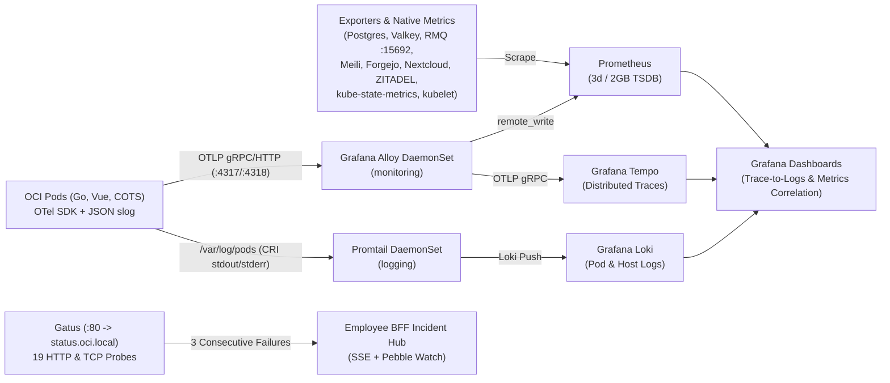
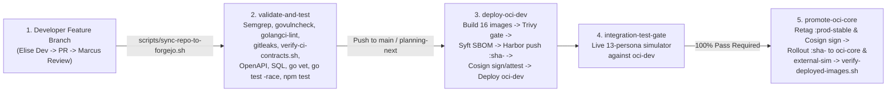

# Observability & Day-2 Operations Guide

This guide documents OCI's telemetry pipelines, continuous delivery promotion workflow, and Day-2 operational procedures.

---

## 1. Observability Stack Architecture

OCI runs a unified, self-hosted observability stack across the **`monitoring`** and **`logging`** namespaces:

### 1.1 Metrics & OpenTelemetry Business Instrumentation
* **Ingestion:** All Go services export OTLP metrics and traces via [`pkg/telemetry`](../../pkg/telemetry/telemetry.go) to `alloy.monitoring.svc.cluster.local:4317`, which batch-writes metrics to Prometheus (`k8s/monitoring/alloy.yaml`) and traces to Tempo.
* **Custom Business, Security & Upstream Metrics ([`pkg/telemetry/metrics.go`](../../pkg/telemetry/metrics.go)):**
  * Customer & Banking: `oci.customer.onboarding.total`, `oci.customer.bank_linking.total`, `oci.upstream.requests.total` (`service`, `status`).
  * Trading: `oci.trading.order_execution.latency` (ms), `oci.trading.bracket_order_fills.total`.
  * Feline & Care: `oci.feline.behavioral_events.total`, `oci.feline.inference.confidence`, `oci.feline.care_schedule_updates.total`, `oci.feline.emergency_hold_toggles.total`.
  * Operations & Security: `oci.operational.pebble_mtta.duration` (s), `oci.waf.blocked_requests.total` (`rule_id`, `category`, `target`).
  * *CI Contract Check #8:* Every `Record*` helper in `pkg/telemetry/metrics.go` must have at least one non-test caller.
* **Prometheus Scrape Targets & Alert Rules ([`k8s/monitoring/prometheus.yaml`](../../k8s/monitoring/prometheus.yaml)):**
  * Scrapes `oci-core` and `oci-dev` RabbitMQ (`:15692`, `/metrics/per-object`), ZITADEL (`/debug/metrics`), Forgejo (`/metrics`), Nextcloud (`nextcloud-exporter:9205`), Meilisearch (`:7700`), `kube-state-metrics`, and kubelet/cAdvisor.
  * **Resource Contract (CI Check #10):** `requests.memory: 512Mi`, `limits.memory: 2Gi`, `--storage.tsdb.retention.time=3d`, `--storage.tsdb.retention.size=2GB`.
  * **30 Alert Rules across 6 categories:** RabbitMQ DLQ/backlog/consumers/memory, COTS latency/auth spikes, node/PVC disk & pod states (`CrashLoopBackOff`, `OOMKilled`, `DeploymentZeroAvailableReplicas`, `StatefulSetReplicasUnavailable`, `ScrapeTargetDown`), backups & cert expiry (`BackupFailedOrStale`, `CertManagerCertExpiringSoon`, `BlackboxSSLCertExpiringSoon`), stateful stores (Valkey, PostgreSQL, Meilisearch), and HTTP `5xx` / upstream error & timeout spikes.

### 1.2 Distributed Tracing & Centralized Logging
* **Cross-Broker Trace Propagation:** [`pkg/envelope/tracing.go`](../../pkg/envelope/tracing.go) injects W3C `traceparent`/`tracestate` into Watermill `message.Metadata`; [`TraceContextMiddleware`](../../internal/app/worker/tracing_middleware.go) restores parent spans inside `oci-worker`, linking BFF $\rightarrow$ BLL $\rightarrow$ Domain API $\rightarrow$ Outbox $\rightarrow$ RabbitMQ $\rightarrow$ Worker in Grafana Tempo.
* **Centralized Pod Logs (Loki + Promtail):** [`k8s/logging/promtail.yaml`](../../k8s/logging/promtail.yaml) uses `kubernetes_sd_configs` (`role: pod`) with CRI parsing (`- cri: {}`) to ship `/var/log/pods` logs to Loki indexed by `namespace`, `pod`, `container`, and `app` labels.

### 1.3 Gatus Service Status (`status.oci.local`)
* [`k8s/monitoring/gatus.yaml`](../../k8s/monitoring/gatus.yaml) monitors **19 in-cluster endpoints** across `customer-public`, `employee-internal`, and `cots-enterprise` (using HTTP `/healthz` for web/BFF/COTS and `tcp://` probes for mTLS gRPC BLLs/Domain APIs and ERPNext/Frappe).
* On 3 consecutive probe failures, Gatus triggers a webhook to `oci-employee-bff` (`/api/v1/employee/incidents/broadcast`), surfacing real-time alerts in the Employee Portal and Pebble watches.

---

## 2. CI/CD & Gated Promotion Operations

OCI runs a completely self-hosted GitOps pipeline in [`oci-internal`](../../.forgejo/workflows/ci.yaml):

### Standard Developer & Release Commands
| Task | Command |
| :--- | :--- |
| **Verify all offline contracts & scanners** | `./scripts/verify-ci-contracts.sh` |
| **Run full monorepo Go race tests** | `go test -v -race ./... && go vet ./...` |
| **Run local 5-tier stack (10 services)** | `./scripts/run-local-dev.sh` |
| **Push local HEAD to Forgejo & trigger CI** | `./scripts/sync-repo-to-forgejo.sh` |
| **Monitor Forgejo Actions run status** | `./scripts/ci-status.sh --wait` |
| **One-command test, sync, wait, verify & sim** | `./scripts/deploy-latest.sh` |
| **Apply Kubernetes manifests (by profile)** | `./scripts/deploy-k8s.sh [--profile all\|dev\|business-only]` |
| **Verify immutable deployed SHA tags** | `./scripts/verify-deployed-images.sh oci-core sha-<COMMIT>` |

---

## 3. Day-2 Operations & Runbook Index

### 3.1 Secrets & PKI Lifecycle
* **Bootstrap / Reconcile OpenBao & Dynamic DB Roles:** Run `./scripts/init-openbao.sh` (or `--db-only` to refresh Postgres dynamic role configs without overwriting KV-v2 secrets). Unseal keys live in `oci-core/openbao-unseal-keys` (see [`scripts/init-openbao.sh`](../../scripts/init-openbao.sh)).
* **Control Plane & Application CA Rotation:** Follow [Control Plane & Host Certificate Lifecycle Runbook](../runbooks/control-plane-cert-rotation.md) annually for MicroK8s control plane certs; intermediate CA rotation for `cert-manager` is automated hourly by `oci-worker`.

### 3.2 Database Backups, Retention & Migrations
* **Manual / Scheduled Backups:** Run `./scripts/backup-db.sh` or trigger `cronjob/postgres-core-backup-cronjob` (`oci-core`) and `cronjob/postgres-internal-backup-cronjob` (`oci-internal`).
* **Staging Retention Hygiene (`oci-dev`):** `k8s/oci-dev/dev-db-retention-cronjob.yaml` runs daily at `03:30 UTC` retaining baseline seed rows + latest 500 synthetic rows. Run `./scripts/prune-dev-db.sh --dry-run` to preview, or `--namespace oci-dev --keep-rows 500` to prune manually (guarded against `oci-core`).
* **Applying Schema Migrations:** Follow [Database Migrations Protocol](../../scripts/migrations/README.md) (`psql -f scripts/migrations/NNN-<name>.sql` and keep `init.sql` + both Postgres ConfigMaps in sync).

### 3.3 COTS, Simulation, Load Testing & Incident Triage
* **COTS Upgrades & Rollbacks:** Follow [COTS Patching & Lifecycle Runbook](../runbooks/cots-patching-lifecycle.md) and `./scripts/cots-maintenance.sh snapshot`.
* **Regenerate Forgejo Simulation Tokens:** Run `./scripts/provision-forgejo-sim-tokens.sh` if `401` errors occur for `emp-human-elise` or `emp-human-marcus`.
* **Stateful Store Alerts (Valkey, PostgreSQL, Meilisearch):** Follow [Stateful Store Alerts Runbook](../runbooks/stateful-store-alerts.md).
* **Load Testing & Runner Eviction Recovery:** Follow [Cluster Load Testing Runbook](../runbooks/cluster-load-testing.md) (always execute the simulator externally from a workstation using `OCI_INGRESS_IP`).
* **Chaos Testing (`oci-dev` only):** Follow [Chaos Engineering Runbook](../runbooks/chaos-engineering.md) and `./scripts/run-chaos-suite.sh`.
* **Monitoring Blind Spots:** Follow [Kubernetes Monitoring Blind Spots Runbook](../runbooks/k8s-monitoring-blind-spots.md).
